# System Design — méthodologie & architecture de référence

Document de cadrage de l'agent **architecte**. Objectif : concevoir l'architecture d'un produit **avant** de coder, puis découper le travail en tâches pour l'équipe.

> Règle : l'architecture se conçoit d'abord, se documente ici, puis se découpe en tâches kanban. On ne code pas sans architecture écrite.

## 1. Architecture de référence (monorepo)

```mermaid
flowchart TB
    subgraph Client["Clients"]
        W["apps/web<br/>Vite + React + Tailwind"]
        M["apps/mobile<br/>React Native + Expo"]
    end

    subgraph Design["Packages"]
        DS["packages/design-system<br/>tokens + composants + thèmes"]
    end

    subgraph Backend["Backend (Node/Express ou Next.js API)"]
        API["API REST / Server Actions"]
        AUTH["Auth (JWT + bcrypt ou Supabase)"]
    end

    subgraph Data["Données"]
        DB["PostgreSQL + Prisma<br/>(SQLite en dev)"]
    end

    W --> DS
    M --> DS
    W -->|HTTPS| API
    M -->|HTTPS| API
    API --> AUTH
    API -->|Prisma| DB
```



- **Clients** : deux apps indépendantes, qui partagent le design system et parlent au même backend.
- **Backend** : un seul service au départ (monolithe modulaire). On ne découpe en microservices **que** si la charge l'exige.
- **Données** : PostgreSQL + Prisma (migrations versionnées), SQLite en dev.

## 2. Décisions à trancher pour chaque projet

Avant de coder, l'architecte répond à chaque question et la documente :

| Question | Options | Défaut |
|---|---|---|
| Backend nécessaire ? | Aucun (statique) / léger (Supabase/Firebase) / complet (Express/Next.js) | complet si données + comptes |
| Base de données | PostgreSQL / Supabase / aucune | PostgreSQL |
| Authentification | Aucune / JWT+bcrypt / Supabase Auth | JWT+bcrypt |
| Multi-tenant ? | Non / oui (isolation par `tenant_id`) | non |
| Temps réel ? | Non / WebSocket / polling | non |
| Fichiers/upload | Aucun / stockage objet | stockage objet si images |
| Échelle visée | Démo / centaines / milliers d'utilisateurs | démo |

## 3. Méthodologie de l'architecte

1. **Exigences** : lister les fonctionnalités et les utilisateurs ciblés (depuis la spec produit dans `docs/`).
2. **Contraintes** : budget, délai, technologies imposées, conformité.
3. **Choix** : trancher les décisions du tableau ci-dessus, justifier en une ligne.
4. **Schéma** : dessiner les composants (clients, API, base, services externes) et leurs flèches.
5. **Modèle de données** : lister les entités principales et leurs relations.
6. **Découpage** : transformer le schéma en tâches kanban (une tâche = un lot cohérent, assignable à un profil).
7. **Risques** : identifier les 2-3 points durs (paiement, temps réel, montée en charge) et leur plan de repli.

## 4. Template de document de system design

Copier ce bloc dans `docs/<projet>/system-design.md` et le remplir pour chaque nouveau projet :

```markdown
# System Design — <Nom du projet>

## 1. Exigences
- Fonctionnalités : …
- Utilisateurs ciblés : …
- Échelle visée : …

## 2. Contraintes
- …

## 3. Décisions d'architecture
| Question | Décision | Justification |
|---|---|---|
| Backend | … | … |
| Base de données | … | … |
| Authentification | … | … |
| Multi-tenant | … | … |
| Temps réel | … | … |
| Fichiers | … | … |

## 4. Schéma
(mermaid ou ASCII — composants + flèches)

## 5. Modèle de données
- `User` : id, email, password_hash, …
- `…` : …

## 6. Découpage en tâches
| Tâche | Profil | Dépend de |
|---|---|---|
| … | architecte | — |
| … | dev-web | … |
| … | dev-mobile | … |
| … | qa | … |
| … | devops | … |

## 7. Risques
- Risque → plan de repli
```

## 5. Montée en charge (quand ça grandit)

À n'activer que si l'échelle l'exige — jamais par anticipation :

1. **Cache** : Redis devant les lectures chaudes.
2. **File d'attente** : jobs longs (emails, exports) hors requête HTTP.
3. **Réplication** : lecture sur répliques, écriture sur primaire.
4. **Découpage** : sortir un service seulement quand une fonction est un goulot d'étranglement isolé.
5. **Monitoring** : Sentry (erreurs), logs structurés, alertes uptime.

> Principe : le plus simple qui fonctionne. Un monolithe modulaire bien conçu tient jusqu'à des milliers d'utilisateurs.
