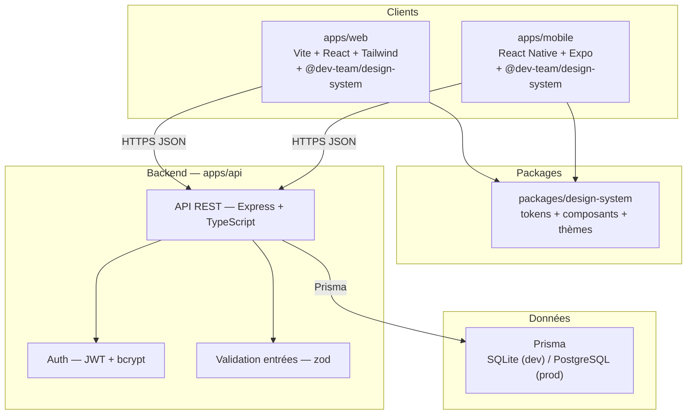

# System Design — Todo App

Document de cadrage produit par l'agent **architecte**. Objectif : valider la pipeline multi-agents (architecte → dev → qa → devops) sur une application de gestion de tâches complète, fonctionnelle et déployable.

## 1. Exigences

- **Fonctionnalités (MVP)**
  1. Inscription / connexion (JWT + bcrypt).
  2. Créer, lister, modifier, supprimer une tâche.
  3. Marquer une tâche « faite » ; filtrer (à faire / faite).
  4. Changement de thème (design system multi-thème).
- **Utilisateurs ciblés** : utilisateur individuel, un compte personnel, usage web (desktop + mobile) et app mobile.
- **Échelle visée** : démo / test de pipeline. Pas de montée en charge attendue.
- **Hors périmètre (v1)** : partage de tâches entre utilisateurs (multi-tenant), notifications, réinitialisation de mot de passe, upload de fichiers.

## 2. Contraintes

- **Stack imposée** (ne pas changer) :
  - Backend : Node.js + Express + TypeScript + Prisma (SQLite en développement).
  - Web : Vite + React + TypeScript + Tailwind + `@dev-team/design-system`.
  - Mobile : React Native + Expo + `@dev-team/design-system`.
  - Authentification : JWT + bcrypt.
- **Monorepo** : `C:/Users/PC/dev-team` — `apps/web`, `apps/mobile`, `packages/design-system`. Le backend va dans un **nouveau dossier `apps/api`**.
- **Design system obligatoire** : `@dev-team/design-system` partout ; aucune couleur, espacement, rayon ou police en dur — uniquement les rôles sémantiques. Thème par défaut `dark`, l'utilisateur peut changer (ex. `ocean`, `forest`, `light`).
- **Cartes** : Leaflet/OpenStreetMap (sans objet ici, aucun besoin de carte).
- **Sécurité** : entrées validées côté serveur, requêtes SQL paramétrées via Prisma, mots de passe hachés, aucun secret commité (`.env` ignoré).
- **Déploiement** : Vercel (web, URL réelle vérifiée). Mobile : build Expo (EAS) — livraison d'un build fonctionnel, pas de publication store obligatoire.
- **État actuel du monorepo** : `packages/design-system` est déjà implémenté (tokens, composants `Button`/`Input`/`Card`/`Badge`, thèmes + `ThemeProvider`, config Tailwind). `apps/web` et `apps/mobile` sont **vides** (à scaffolder). `apps/api` n'existe pas.

## 3. Décisions d'architecture

| Question | Décision | Justification |
|---|---|---|
| Backend | **Complet** : Express + TypeScript dans `apps/api` | Comptes + données ⇒ backend nécessaire. Express imposé par la spec. |
| Base de données | **SQLite en dev**, PostgreSQL en prod (Prisma) | Spec impose SQLite en dev ; Prisma rend le passage à PostgreSQL transparent via le provider. |
| Authentification | **JWT + bcrypt** | Imposé. JWT courte durée (ex. 15 min) + refresh, cookies httpOnly, CORS limité aux origines web/mobile. |
| Multi-tenant | **Non** | Hors périmètre v1. Chaque utilisateur ne voit que ses tâches via la relation `userId`. |
| Temps réel | **Non** (aucun polling) | Pas de collaboration ni de sync multi-appareils en v1 ; refetch à la connexion et après chaque mutation. |
| Fichiers / upload | **Aucun** | Hors périmètre v1. |
| Thème | **Côté client uniquement** (localStorage) | Le thème est une préférence d'affichage ; aucun champ serveur nécessaire en v1. |
| Échelle visée | **Démo** | Monolithe modulaire ; pas de cache, file, réplication ni découpage (cf. méthodo §5). |

## 4. Schéma

- **Clients** : deux apps indépendantes partageant le même design system, parlant à la même API REST.
- **Backend** : un seul service (monolithe modulaire) dans `apps/api`. Routes `/auth/*` et `/tasks/*`.
- **Données** : Prisma avec migrations versionnées ; SQLite en dev, PostgreSQL en prod.

## 5. Modèle de données

- **`User`**
  - `id` : String (cuid, PK)
  - `email` : String, unique, not null
  - `password_hash` : String, not null (bcrypt, jamais en clair)
  - `created_at` : DateTime, not null
  - `updated_at` : DateTime, not null
- **`Task`**
  - `id` : String (cuid, PK)
  - `title` : String, not null
  - `done` : Boolean, not null, default `false`
  - `user_id` : String, FK → `User.id` (not null)
  - `created_at` : DateTime, not null
  - `updated_at` : DateTime, not null

Relations : **`User` 1 — N `Task`** (un utilisateur possède plusieurs tâches ; une tâche appartient à un seul utilisateur).

Choix volontaires :
- Pas de champ `description` en v1 (non demandé par le MVP) ; ajoutable par migration réversible si besoin.
- Le thème n'est **pas** persisté en base (préférence client, localStorage).
- `done` est un booléen simple ; le filtre « à faire / faite » se fait par requête sur `done`.

## 6. Découpage en tâches

Ordre : **architecte → backend → web / mobile (parallèles) → qa → devops**.

| # | Tâche | Profil | Dépend de |
|---|---|---|---|
| 1 | System design (ce document) | architecte | — |
| 2 | Backend API `apps/api` : Express + TS + Prisma (SQLite), auth JWT+bcrypt, CRUD `/tasks`, validation entrées (zod), erreurs structurées, tests d'intégration | dev-web | 1 |
| 3 | App web `apps/web` : scaffold Vite + React + Tailwind, intégration `@dev-team/design-system`, écrans inscription/connexion, liste + CRUD tâches, filtre, sélecteur de thème, responsive | dev-web | 2 |
| 4 | App mobile `apps/mobile` : scaffold Expo, intégration tokens/thème `@dev-team/design-system`, mêmes écrans, build Expo | dev-mobile | 2 |
| 5 | QA : tests API (entrées validées, codes HTTP, erreurs), tests web responsive desktop/mobile, changement de thème, absence de secret commité | qa | 3, 4 |
| 6 | Déploiement Vercel (web) + config env API, vérification `.env` ignoré, URL réelle vérifiée | devops | 5 |

Note d'affectation : il n'existe pas de profil `dev-backend` ; la tâche backend (API Node/Express) est confiée à **dev-web**, qui exécute les tâches 2 puis 3 en séquence.

## 7. Risques

- **Prisma/SQLite ↔ PostgreSQL en prod** → garder le provider configurable via `.env` (fichier `schema.prisma` avec `provider = env("DATABASE_PROVIDER")` ou bascule documentée) ; tester en SQLite, déployer en PostgreSQL.
- **CORS + cookies httpOnly entre domaines Vercel et API** → définir les origines autorisées par variable d'environnement ; vérifier en QA avant déploiement.
- **Design system côté mobile (Expo)** → `@dev-team/design-system` est basé sur du web (Tailwind + composants React) ; vérifier la compatibilité Expo avant le dev mobile ; sinon exposer uniquement les **tokens/thèmes** côté mobile (c'est ce que prévoit la spec).
